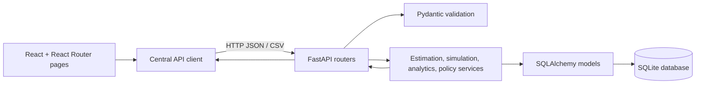
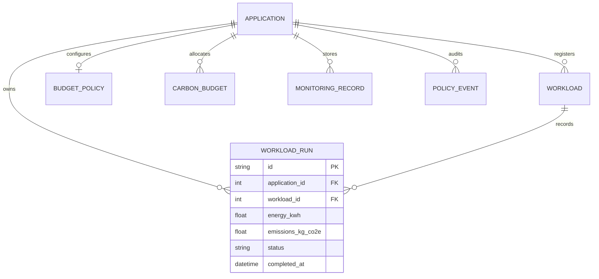

# CarbonGuard Architecture

## Phases 1 through 8

Phase 1 provides the React/Vite frontend, FastAPI backend, local CORS setup,
health/status endpoints, and explicit unavailable metric placeholders. Phase 2
adds SQLite persistence, SQLAlchemy models, Alembic migrations, Pydantic API
schemas, and REST endpoints for application records. Neither phase performs
workload execution, automatic monitoring, or policy enforcement. Phase 3 adds a
stateless energy/emissions estimation service and API; calculations use
caller-supplied average power, duration, and carbon intensity. Phase 4 adds a
bounded simulator which generates reproducible relative power profiles and
passes the caller-provided mean power and duration through the Phase 3
estimator.

## Components and request flow

The browser loads the Vite React application. React Router renders distinct
Overview, Workloads, Applications, Analytics, Policies, and Recommendations
routes inside a shared responsive shell. `App` reads API connection state
through `useApiHealth`; its service calls `GET /api/health`. Feature pages use
the centralized `frontend/src/services/api.js` client rather than embedding
endpoint URLs throughout the UI.

For data requests, FastAPI route handlers validate Pydantic input, acquire a
request-scoped SQLAlchemy `Session` through `get_db`, and read or persist ORM
entities. `backend/app/db/session.py` reads `DATABASE_URL` (and an optional
backend `.env`) and defaults to `backend/data/carbonguard.db`. Schema changes
are applied only through Alembic; application startup does not create or reset
tables.

The estimate route validates its request with a dedicated Pydantic schema and
delegates to `app/services/estimation.py`. The service returns computed values,
units, assumptions, and an `estimated` source marker. It does not write
estimates to the Phase 2 database.

The simulation route validates an existing application, creates or reuses its
registered workload definition, generates 60 relative power samples without
running host workloads, and delegates energy/emissions calculations to that
same estimation service. It persists a unique `WorkloadRun` record, including
the input parameters, seed, relative profile, timestamps, and estimation
results. A supplied seed reproduces the profile, not the run ID or timestamps.
CPU utilization is descriptive only and is not translated into physical
power.

Phase 5 adds a separate `BudgetPolicy` configuration and evaluation service.
The service evaluates completed workload runs using their stored emissions,
without rerunning the estimator. Each request captures one UTC reference time
and calculates daily, Monday-based weekly, or calendar-month UTC boundaries.
Run `completed_at` timestamps are filtered within the half-open interval
`[period_start, period_end)`. The response includes contributing run IDs and
the stored source/method, consumption, remaining budget, utilization, status,
and an action recommendation. No enforcement event or infrastructure action
is performed.

Phase 6 adds read-only analytics over completed workload runs. SQL aggregates
provide all-time totals and application comparisons; daily aggregates are
bucketed into UTC daily, Monday-based weekly, or calendar-month trend buckets.
Trend ranges are bounded to 366 days and use `[start, end)` filtering.
Explicitly empty chart buckets are zero-filled with `is_empty: true`.
Filtered workload analytics return application aggregates, actual run values,
and status counts with the same UTC date/application filters. Run detail is
capped at 5,000 records, and completed-run energy/emissions totals exclude
failed runs. The dashboard reuses these records for responsive Recharts
visualizations and uses separate axes for unlike units.
Policy statuses displayed with analytics are evaluated on request using the
Phase 5 evaluator. They are current-period snapshots, not stored historical
policy events. The CSV export includes run estimates and clearly labeled
current policy snapshot values; it does not export secrets.

Phase 7 adds validated CORS configuration, security response headers, a
1 MiB request-body limit, explicit numeric and pagination bounds, and
spreadsheet-formula neutralization in CSV exports. Time-filtered workload-run
queries use two additive composite indexes managed by Alembic. Dashboard
analytics requests have finite timeouts, validate response shapes, and abort
superseded requests. The application still has no authentication or
authorization system; deployment access control is an external responsibility.

## Container deployment

The Compose deployment has two services and no external database service.
`backend` builds the existing FastAPI application, applies the Alembic head
before starting Uvicorn, runs as a non-root user, and stores SQLite at
`/data/carbonguard.db` in the named `carbonguard-data` volume. Its health check
calls `/api/health`. `frontend` builds the existing Vite application in a
Node build stage and serves the static output from Nginx. Browser API requests
use relative `/api` paths and Nginx proxies them to the Compose `backend`
service; the browser never needs to resolve a container hostname. The frontend
waits for the backend health check before starting. Host ports bind to loopback
by default.

## Persistence model

- `Application` has one-to-many relationships with budgets, workloads,
  monitoring records, and policy events, plus at most one `BudgetPolicy`. Its
  name is case-insensitively unique.
- `CarbonBudget` stores positive kg CO2e allocations, a warning threshold, and
  a daily, weekly, or monthly period for the existing Phase 2 budget API.
- `BudgetPolicy` stores the Phase 5 evaluation budget, warning/critical
  thresholds, enabled state, and recommendation action. A unique application
  index enforces one policy per application; it is separate from legacy
  `CarbonBudget` records.
- `Workload` stores registration metadata only.
- `WorkloadRun` stores each bounded simulation result and its generated
  profile; it references both its application and registered workload.
- `MonitoringRecord` stores submitted nonnegative energy/emissions values and
  provenance. It does not calculate emissions.
- `PolicyEvent` stores audit-style event types and messages; it does not make
  policy decisions.
- `ExperimentResult` stores JSON results entered manually or imported; it does
  not run experiments.

All application foreign keys use `ON DELETE RESTRICT`. The API also refuses
to delete an application while it has any budget, budget-policy configuration,
workload, monitoring record, policy event, or simulation run. This preserves
history. Phase 2 budgets can be individually removed. Timestamps are stored
and returned as UTC.

## Architecture diagram

## Database relationship diagram

Evaluation status is `exceeded` when consumption is above 100% before checking
the critical threshold, so an over-100 critical threshold cannot mask an
exceeded budget. Otherwise critical and warning thresholds are checked in
descending order. Consumption and remaining values are rounded to 12 decimal
places and utilization to 6 decimal places; comparisons use unrounded decimal
values. Recommendations are advisory: monitor-only policies never request
intervention; warn policies recommend warnings at warning status or above;
recommend-throttle policies recommend warnings at warning status and
throttling at critical/exceeded status. No actual workload is controlled.

## Folder structure

- `backend/app/main.py`: FastAPI app, CORS, and router registration.
- `backend/app/core/config.py` and `backend/app/core/middleware.py`: validated
  CORS settings, security response headers, and request-body size limit.
- `backend/app/api/`: health/status and application/resource endpoints.
- `backend/app/db/`: declarative metadata, SQLite-aware UTC type, engine, and
  request session dependency.
- `backend/app/models/entities.py`: eight persistent SQLAlchemy entities.
- `backend/app/schemas/`: validated request and response models.
- `backend/app/services/database.py`: shared lookup, conflict, and deletion
  helpers.
- `backend/app/services/estimation.py`: power-duration calculation and
  assumptions.
- `backend/app/services/simulation.py`: bounded profile generation and
  run-history persistence; delegates calculations to the estimator.
- `backend/app/services/policies.py`: fixed-clock UTC period calculation and
  deterministic aggregation of stored workload-run estimates.
- `backend/app/schemas/policies.py`: policy configuration and evaluation
  contracts.
- `backend/migrations/versions/c9f21e6a7b34_add_budget_policies.py`: additive
  policy-table migration.
- `backend/migrations/versions/d47e1b9c2a63_add_workload_run_analytics_indexes.py`:
  additive composite indexes for time-filtered workload-run queries.
- `backend/app/schemas/estimates.py`: validated estimation request/response.
- `backend/app/schemas/simulation.py`: simulation limits and run response.
- `backend/app/api/estimates.py`: stateless `POST /api/estimates` endpoint.
- `backend/app/api/simulation.py`: simulation and run-history endpoints.
- `backend/app/api/policies.py`: policy CRUD, evaluation, and application status.
- `backend/app/api/analytics.py`: overview, trends, application comparison,
  policy snapshots, application analytics, and CSV export.
- `backend/app/services/analytics.py`: bounded UTC trend aggregation,
  application/overview summaries, policy snapshot reuse, and CSV serialization.
- `backend/app/schemas/analytics.py`: analytics response contracts.
- `backend/migrations/`: Alembic environment and initial schema migration.
- `backend/tests/`: API tests using a separate temporary SQLite database.
- `frontend/src/`: React application, API health indicator, Phase 5 policy
  interface, and analytics dashboard using Recharts.
- `backend/Dockerfile`, `frontend/Dockerfile`, and `frontend/nginx.conf`:
  production-oriented container build and same-origin API proxy.
- `docker-compose.yml`: backend/frontend services, health checks, and
  persistent SQLite volume.
- `docs/`: architecture, API contract, setup, demo, and release tracking.

## Later extension points

Future phases can add measured telemetry and regional carbon-intensity sources;
simulated estimates must not be described as measurements. Real workload
enforcement, cloud controls, database history for each policy evaluation,
automated scheduling, and PDF reporting remain out of scope.
